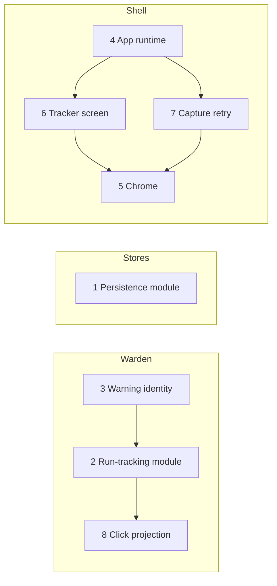

# Architecture plan

Eight deepening refactors found by the architecture review of 2026-11-02. Each one replaces several shallow
modules, or a duplicated implementation, with one deep module behind a small interface, so that a change, a bug or a
test lives in one place. None of them changes what a tool does for the player.

Words as in the design vocabulary: **module** (anything with an interface and an implementation), **interface**
(everything a caller must know), **depth** (behaviour per unit of interface), **seam** (where an interface lives),
**adapter** (a thing that satisfies an interface at a seam), **leverage** (what callers gain), **locality** (what
maintainers gain). A seam is only worth adding when something really varies across it (two adapters).

## Rules for every item

- Behaviour preserving. The suites that pass before an item pass after it, except tests that pinned wording or
  incidental output, which are deleted, not re-pinned (see AGENTS.md).
- Clean cutover: every caller moves in the same item; no aliases, re-exports or deprecated paths are left behind.
- Tests go through the new interface. A test of a private helper that the new module swallowed is deleted, and the
  behaviour it covered is tested through the interface.
- Packages never import from apps. `apps/warden` is GPL-3.0-only and `apps/vorax` is MIT: nothing is copied between
  them; what both need goes into `packages/*`. Items 2, 3 and 8 stay inside `apps/warden/ts`.
- Never touch the game: nothing here reads memory, sends input or uses the network.
- Docs move with the code: the README of each app or package touched, and the matching page in `docs/`.
- Commits: Conventional Commits, one logical change each; an item is several commits (prepare, move, delete), never
  one.
- A new package with tests or a `tsconfig` goes into the root `test` and `typecheck` chains.
- When an item names a module that is not in `GLOSSARY.md`, the term is added there in the same item (the file does not
  exist yet; the first item that needs it creates it). No ADRs exist; an item that is dropped for a reason a later
  review would need gets one.
- Verified with `bun run test` and `bun run typecheck` at the end of every item, and the app's own suite and its
  `tui-smoke.py` where the item touches a screen. Warden's tests run with `TLI_NO_CAPTURE=1`.

## Order

The order is the priority: value first, then risk, then what unlocks what. Items on different tracks touch different
files and can run at the same time; on one track they run in order.

| Order | # | Item | Track | Strength | Why here |
|---|---|---|---|---|---|
| 1 | 3 | Warning identity | Warden | Strong | Small, and removes the prose parsing that item 2 would otherwise have to carry across |
| 2 | 2 | Run-tracking module out of `Session` | Warden | Strong | Biggest module in the repo, the rules are spelled five times, the hardest logic has no synthetic test |
| 3 | 1 | One persistence module under both stores | Stores | Strong | Two copies of ~150 lines already drifting; independent, so it can start on day one beside 3 |
| 4 | 4 | App runtime in `startApp` | Shell | Strong | Touches all five apps' start-up; must land before 6, 5 and 7 edit the same files |
| 5 | 6 | Tracker screen draws only | Shell | Worth exploring | Shrinks `apps/tracker/src/screen.ts` before item 5 reshapes its header and footer |
| 6 | 7 | Capture retry policy behind the capture seam | Shell | Worth exploring | Edits `vorax/scripts/tui.ts` and `warden-tui.ts`, so after 4 |
| 7 | 5 | Header and footer chrome in `packages/tui` | Shell | Worth exploring | Last on the shell track: it edits every `screen.ts`, so it comes after 6 has emptied the tracker's |
| 8 | 8 | One home for projecting the advised click | Warden | Speculative | Reads `Session.mark` and `markOn`, which item 2 moves; do it only if a second resolution bites |

Shared files, so the order on a track is not optional:

| File | Items that edit it | Order |
|---|---|---|
| `apps/warden/ts/src/app/session.ts` | 3, 2, 8 | 3, 2, 8 |
| `apps/vorax/scripts/tui.ts`, `apps/warden/ts/src/bin/warden-tui.ts` | 4, 7 | 4, 7 |
| `apps/tracker/src/app.ts`, `apps/tracker/src/screen.ts` | 4 (ctrl+c), 6, 5 | 4, 6, 5 |
| every `apps/*/**/screen.ts` | 5 | after 4 |
| `packages/tracker/src/store.ts`, `packages/arcana/src/store.ts` | 1 | alone |

### A baseline to settle before item 2

`apps/warden/ts/tests/session-frames.test.ts` returns early when `trainingdata/s16` is missing, and the folder is
git-ignored and not in this checkout. Item 2 moves the logic those tests guard, so before it starts:

1. Find out which of the frame, flow and instrument tests actually run on this machine (a skipped test passes). Put the
   folder in place, or list what is not covered.
2. For what is not covered, write the run-tracking tests on synthetic `(scene, panels)` input first (step 2 of item 2),
   not after the move.

Item 3 is lower risk because `reader-units.test.ts` and the fixtures in `tests/fixtures/` run everywhere.

---

## Item 3: Warning identity

**Problem.** The reader builds a sentence (`reader/model.ts`: `cellWarning(n, 'Check cell 3,4: … (confidence 0.62).')`),
and `Session` parses it back: `steadyKey` slices the text at `'confidence '` and tests `startsWith(CHECK_CELL)`
(`session.ts:251-256`), `rebuild` filters by `startsWith(CHECK_CELL)` although `Warning.cell` is already there
(`:1323`), and `keptLine` matches five strings by equality or prefix (`:101-102`). `Session` also writes `Check cell …`
sentences itself (`:305`). Reword one and a filter silently stops matching.

**Change.** A `Warning` carries what the session needs as data: its kind (extending `WarningKind`), its cell, and for a
low-confidence read the confidence and what was read. The sentence is made from it when shown, in one place. The
"kept over the next read" lines get a kind of their own instead of a string list.

**Steps.**
1. In `reader/model.ts`, widen `Warning` (data fields, not prose) and build the sentence from them in one formatter.
   The sentences the player sees stay the same.
2. Move `steadyKey` to key on `(cell, kind, what was read)`; delete the `confidence ` slicing.
3. Replace `startsWith(CHECK_CELL)` and the `keptLine` string tests with kind checks; delete `CHECK_CELL`, `POPUP`,
   `OFF_BOARD`, `FADING`, `THEME_READ` and `SHAPE` as matching strings (they stay as sentence text in the formatter).
4. `tui/view.ts` and `tui/screen.ts` read the formatted text; the three filters in `view.ts:344-346` become kind and
   cell checks.
5. Tests: `reader-units.test.ts` asserts warning identity (cell, kind, confidence) from a real frame, not the
   sentence; one test in `session.test.ts` proves steadiness keys on identity (the same read twice counts; a different
   confidence on the same cell does not break the count).

**Done when.** No `indexOf`, `startsWith` or `===` on warning text is left in `src/app` or `src/tui`, and `grep -n
"text.startsWith\|text ===" apps/warden/ts/src` finds none on a `Warning`.

**Risks.** Existing tests that assert the sentences (`session-flow`, `session-frames`) keep passing only if the formatter
reproduces them. That is a reason to keep the sentences identical, not to pin them; where a test asserts a sentence for
its own sake, assert identity instead.

## Item 2: Run-tracking module out of `Session`

**Problem.** `Session` (1820 lines, ~30 private fields) holds the frame scheduler, the auto-read `Watch`, the run state
machine, the solve worker, the player's corrections, the run log and the overlay marks. The run state machine
(`takeRead` 887-1141, `rebuild`/`build` 1283-1452) is the largest part and has no interface of its own; the only way to
reach it is the whole pipeline with PNG frames. "Which screens count as a board" is a literal five times with two
different sets (`:957`, `:978`, `:1087`, `:1299`, `:1357`).

**Change.** A run-tracking module that takes one installed frame, `(scene, panels, days read)`, and answers with the
board, the warnings and the run events (started, over). It owns the meal, the consume targets, the vault top, prey seen,
the chain, the treasure, the days clock and the screen classes. `Session` keeps scheduling, the worker, corrections, the
run log and projection to the view.

**Steps.**
1. Baseline (see above). Run `bun run --cwd apps/warden/ts test` with `TLI_NO_CAPTURE=1` and note what is skipped.
2. Write the missing behaviour tests against the module's future interface on synthetic `(scene, panels)`: a higher day
   count twice is a new run, a blip is confirmed on the second read, a fading `chainTarget` frame keeps the last board,
   a popup keeps the last reading. Where there is no module yet, write them against `Session` with injected `scene` and
   `panels` (the frame reader is already injectable through `readInBackground`; extend it if it is not).
3. Name the screen classes once (a real board; a board a pick covers; a board that resets chains) and replace the five
   literals. If two of the literals are different on purpose, say why in the module; if not, this fixes a bug and gets
   its own `fix(warden)` commit with a test.
4. Move the state and `takeRead`/`rebuild`/`build`/`endRun` into the new module, in steps that each keep the suite
   green: fields first, then the transition, then the run log hook.
5. `Session` delegates; delete what it no longer needs. Anything that stays `private` in `Session` only to be reached by a
   test goes.
6. Frame tests shrink to what they exercise: pixel reading and the scheduler.

**Done when.** `session.ts` is under about 1000 lines, the screen literals are gone, and the run rules are tested with no
PNG.

**Risks.** Highest on this plan: behaviour that only the missing frames guard. Mitigation is step 2 first, small commits,
and a replay of recorded frames before the final commit if the folder is available. Use two alternative interfaces
(design it twice) before step 4; the interface is the decision that matters.

## Item 1: One persistence module under both stores

**Problem.** `packages/tracker/src/store.ts` (963 lines) and `packages/arcana/src/store.ts` (855) carry the same
algorithm twice: `openDb` (pragmas, `user_version`, refusing a newer version, the foreign-tables check, the migration
loop, close on error), `isUnusable`, `openForSave` (`.corrupt` quarantine), the `state.json` to `.imported` import, and
`dataDir`. They differ by an error class name; the arcana message still says "the tracker database". The two interfaces
also differ: `loadTracker`/`saveTracker`/`dbPath`/`SavedTracker` against `load`/`save`/`statePath`/`Saved`.

**Change.** One persistence module owns the life of a database file: opening it, bringing it to the current schema,
refusing a newer one, setting a bad one aside, importing the old JSON once, and finding the data directory. Each tool
is an adapter with a migration list, the row mapping for its own tables, and its saved type. Two adapters make the seam
real.

**Decisions to settle first.**
- Where it lives. A new `packages/store` (`@tli/store`) is the clean answer; `@tli/arcana` already imports
  `@tli/tracker` for its kit, but persistence is not tracker's. Add it to the root `test` and `typecheck` chains.
- Names. Recommended: keep `loadTracker`/`saveTracker`/`trackerDbPath`, rename arcana's `load`/`save`/`statePath` to
  `loadArcana`/`saveArcana`/`arcanaDbPath`, and update every caller (the dashboard's `status.ts`, the arcana TUI, both
  replay scripts, the tests, the READMEs). Clean cutover, no aliases.
- Bag and price rows are the same domain fact in both stores (`SlotRecord`, `InstanceRecord`, `PriceRecord` in arcana's
  session; the tracker's first migration). Mapping them once is a follow-on inside this item only if the diff stays
  small; otherwise it is recorded here as the next item, not done half-way.
  Not done: the write logic around those rows differs too much between the two stores (the tracker's tables are keyed
  per character, Arcana's are not), so mapping them once is the next item, not done half-way here.

**Steps.**
1. Write a contract suite for the persistence module's behaviour (new file, an old file, a corrupt file, a newer
   version, a legacy JSON, a save that changes nothing writes nothing). Run it against the tracker store first; it must
   pass on today's code (`packages/tracker/tests/store.test.ts` has most of these cases).
2. Create `@tli/store`, move the shared algorithm, give the tracker store a thin adapter; the tracker suite stays green.
3. Move arcana onto it; run the same contract suite against both; fix the arcana error message by deleting the
   duplicate.
4. Rename arcana's exports and update the callers; update `packages/*/README.md`.
5. Delete the old copies and the tests that now only repeat the contract suite.

**Done when.** `openDb`, `isUnusable`, `openForSave` and the legacy import exist once, and one suite runs against both
adapters.

**Risks.** Low: pure moves with good existing tests. The data on disk must stay readable: a database written before the
change opens after it, and the contract suite includes a fixture file for each schema version.

## Item 4: App runtime in `startApp`

**Problem.** `packages/tui/src/app.ts` restores the terminal and stops there. Every app then wires the same things:
`renderer.keyInput.on('keypress', onKey)` with an unsubscribe on `destroy` (arcana `tui.ts:173`, tracker `:153`, vorax
`:352`, warden-tui `:158`, dashboard `main.ts:166`), a `ctrl+c` check inside each `key()` (four apps), a `quit()`
that stops and exits (three), and its own tick for redraw and save. Eight test files mount `keyInput` by hand.

**Change.** `startApp` takes a key handler and optional tick and save callbacks, and owns the ctrl+c check, the
subscribe and unsubscribe, quit, and the redraw and save cadence. The apps give handlers and nothing else.

**Decisions to settle first.** Which part of the tick is shared (redraw cadence, save interval) and which stays the
app's (arcana's chunked saves during a long backfill, vorax's capture watch). A callback for the app's part is the
answer; do not grow the runtime to hold app policy. Whether `App` also exposes a test driver (press key, advance tick)
so the eight test rigs shrink.

**Steps.**
1. Extend `StartAppOptions` and `App`; tests in `packages/tui/tests` drive keys, quit sequencing, ctrl+c and
   shutdown-once with the test renderer.
2. Move the apps one at a time, in this order: arcana (the model start-up), tracker, dashboard, warden-tui, vorax. Each
   is a commit; each deletes its key wiring, `quit()`, and ctrl+c check.
3. Replace the hand-mounted `keyInput` in the app tests with the shared driver where one exists.
4. README of `packages/tui`.

**Done when.** `grep -rn "keyInput.on('keypress'" apps --include=*.ts` outside tests finds nothing, and no `key()`
compares `key.ctrl && key.name === 'c'`.

**Risks.** The terminal must still be restored on every way out; `startApp` tests already cover signals, so extend them
rather than replace them, and run each app's `tui-smoke.py`.

## Item 6: Tracker screen draws only

**Problem.** `apps/tracker` holds interaction state twice: `ViewState.editing`, `naming` and the filters in `view.ts:60-104`,
and the screen's own `editingItem`, `naming` and input text (`screen.ts:170-215`). Every edit flow keeps them in step
with paired calls (`beginPrice`/`endPrice`/`beginName`, `onSearch` copying text back) at six sites in `app.ts`, and
`clamp()` exists because two modules hold pointers. `apps/arcana`'s screen already draws only.

**Change.** `ViewState` owns all interaction state, including which input is open and its text. The screen renders a
`ViewState` and raises mouse hooks; it keeps nothing the view could be asked for.

**Steps.**
1. Tests first at the view level: open price edit, type, accept, cancel; naming; search narrowing the rows and clamping
   the cursor, asserted on `ViewState` and the rows, not on widgets. Keep `tests/screen.test.ts` for what is drawn.
2. Move the input state into `ViewState`; make `beginPrice`/`endPrice`/`beginName`/`beginSearch`/`endSearch` derive from
   it; delete the sync calls from `app.ts` one flow at a time.
3. Decide what the input widget still keeps (the cursor in the text field is the widget's); everything else is read
   from the state. Remove `JSON.stringify(rows)` as the diff key if `ViewState` can say what changed.
4. `apps/tracker/README.md` if a key or a prompt changed (it should not).

**Done when.** The screen has no field that mirrors a `ViewState` field.

**Risks.** Text input is the fiddly part: focus, the cursor, paste. Smoke it with `tui-smoke.py` and by hand in a terminal.

## Item 7: Capture retry policy behind the capture seam

**Problem.** `vorax/scripts/tui.ts:204-285` has the retry logic twice (`grab()` and the watch tick) and
`warden-tui.ts:163-213` has it again: `retryAt`, `lastCaptureError`, a 2 s back-off, the gate check, and the status
string. Nothing tests the retry window; `packages/capture/tests/status.test.ts` and `packages/gamelog/tests/status.test.ts`
cover planning and permission only.

**Change.** The capture interface (`captureMinigame`, `packages/gamelog/src/index.ts:344-443`) tracks the back-off
window and the last error, takes `force` to bypass it (vorax's manual grab already has this idea), and returns a composed
status. The apps keep their own frame-to-decision callback. The code goes into a shared package, so nothing crosses the
GPL/MIT line.

**Decisions to settle first.** Whether the state lives on a small object the app creates once, or in the existing
tracker object (`MinigameTracker`); the first is simpler. The clock is injected so the tests do not wait.

**Steps.**
1. Tests with a fake capture and a fake clock: error sets the window; a call inside the window does not capture; `force`
   does; success clears the error; the status string says the gate or the error, not both.
2. Add the module; move vorax's two copies onto it (that alone proves it, as they must agree); then warden-tui.
3. Delete `retryAt`, `lastCaptureError` and the try/catch bodies from both apps.

**Done when.** `grep -rn retryAt apps` finds nothing.

**Risks.** Low, and the 2 s figure stays what it is today in both apps. A behaviour difference between the two copies is
a finding to write down, not to paper over.

## Item 5: Header and footer chrome in `packages/tui`

**Problem.** `chrome.ts` offers chips, hints and meters, but each of the five `screen.ts` files builds the header bar
and the footer by hand and fits the hints to the width with its own rule: arcana drops from the end
(`screen.ts:459-462`), the dashboard keeps the first and last and drops the middle (`:695-698`), warden cuts the brand
to two chunks (`tui/screen.ts:204`), tracker and vorax fold the status into the hint row. No test checks how a bar
shrinks.

**Change.** A chrome module takes brand, chips, hints and an optional message, and decides what shrinks first, once. The
focus border style goes with it. Screens pass data and place the result.

**Decisions to settle first.** The one shrink rule. Pick it from what the player needs on a narrow terminal (the quit
and menu keys last to go), then make all five apps follow it; that changes what a narrow screen shows, so it is named in
the commit and the README of each app. Whether the message replaces the hints (arcana, dashboard) in all apps.

**Steps.**
1. Tests in `packages/tui/tests` for the shrink rule across widths: the width is never exceeded, the keys that must
   survive do, and a message replaces hints.
2. Add the module; move the dashboard first (it has the most elaborate rule), then arcana, warden, vorax, tracker.
3. Delete each screen's header and footer building and its fit loop. Keep each app's snapshot tests; update the ones
   that show a narrow terminal.

**Done when.** `chunksWidth` and `hintChunks` are used by the chrome module and not by any `screen.ts`.

**Risks.** The visible change on narrow terminals. It follows the palette work (975695a and the commits after it); it
does not reopen it.

## Item 8: One home for projecting the advised click

**Problem.** Where to outline the advised move is spread over four modules and two scalings: `reader/click.ts`
(`target`, `toFrame`: reference pixels to frame pixels), `Session.mark` and `Session.markOn` (frame pixels divided by
`Session`'s private `size`, to compositor pixels), `tui/app.ts:46-47` (hands in `capture.area()`), and
`packages/overlay` (`Rect`). Only the shape tests in `session-frames.test.ts:146-178` touch it.

**Change.** The mark is decided in reference pixels in one module, and projected onto the screen in one function of
`(frame size, interface scale, capture area)` with no capture in it.

**Do it only if** a second resolution or interface scale shows a wrong outline, or item 2 leaves the two functions with
nothing else around them. Otherwise leave it: the seam has one caller and the deletion test says it would only move
about 30 lines.

**Steps.** Tests of the projection with plain numbers for a scaled window, a non-16:9 frame and an interface scale;
move the two functions; delete the `size` field that exists only for `markOn`.

**Done when.** The projection has tests that need no capture, and `Session` does not know the compositor.

---

## Left out on purpose

- `warden-cli` and `warden-tui` both define `asRgba` (3 lines). Not worth an item; fix it in passing when one of those
  files is open anyway.
- `apps/dashboard/src/launch.ts` has its own shell quoting beside `packages/launch/src/tmux.ts`. One caller, about 25
  unique lines: deepen it when a second multi-tool launcher appears.
- Baseline refresh is orchestrated and worded separately in `apps/tracker/src/tui.ts` and `apps/dashboard/src/main.ts`,
  though `refreshBaseline` exists in `packages/tracker/src/baseline.ts`. Small; do it when either file is open for
  another reason.
- "Follow the log, restore, save" skeletons in five scripts, and the `arg`/`flag` helpers repeated eight times. The
  differences are real policy (arcana's chunked backfill saves); item 4 takes the shared part that is already clear.
  Revisit once item 4 has landed.
- `packages/tracker/src/engine.ts` `feedLine` switch: deep, with an interface that is fine. Not touched.

## How this plan is carried out

One item at a time per track, in the order above. For each item: settle its open decisions with a short design pass (for
items 1, 2 and 4, two alternative interfaces, then pick one), write the tests that will survive, move callers in small
commits, delete what is dead, run `bun run test` and `bun run typecheck`, update the docs, and tick the row below.

| # | Item | State |
|---|---|---|
| 3 | Warning identity | done |
| 2 | Run-tracking module | done |
| 1 | Persistence module | done |
| 4 | App runtime | done |
| 6 | Tracker screen draws only | done |
| 7 | Capture retry policy | done |
| 5 | Header and footer chrome | open |
| 8 | Click projection | open, conditional |
